# Nexora

Nexora is an AWS-hosted, multi-service application demonstrating Infrastructure as Code (IaC), CI/CD automation, container orchestration, and end-to-end observability.

The project uses Terraform to provision AWS infrastructure, Ansible to configure and deploy services, GitHub Actions to automate CI/CD, and Docker Swarm to orchestrate the application containers.

## Architecture

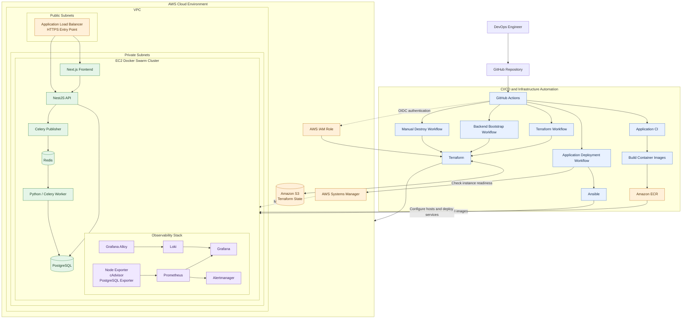

### AWS infrastructure

The infrastructure is provisioned using Terraform and includes:

- VPC with public and private subnets.
- EC2 instances forming a Docker Swarm cluster.
- Application Load Balancer (ALB) for application traffic.
- Route 53 hosted zone and DNS records.
- AWS Certificate Manager (ACM) for HTTPS certificates.
- Amazon ECR for container image storage.
- AWS Systems Manager for managed instance access.
- Amazon S3 for Terraform remote state.

The ALB terminates HTTPS traffic and uses host-based routing to direct requests to the frontend and API target groups. HTTP requests are redirected to HTTPS.

## Technology Stack

| Area | Technologies |
|---|---|
| Frontend | Next.js |
| Backend | NestJS |
| Background processing | Python, Celery |
| Message broker | Redis |
| Database | PostgreSQL |
| Cloud | AWS |
| Infrastructure as Code | Terraform |
| Configuration management | Ansible |
| Containerization | Docker |
| Orchestration | Docker Swarm |
| CI/CD | GitHub Actions |
| Container registry | Amazon ECR |
| Monitoring | Prometheus, Grafana, Alertmanager |
| Logging | Grafana Alloy, Loki |
| Infrastructure access | AWS Systems Manager |

## Repository Structure

```text
.
├── .github/workflows/       # CI/CD and infrastructure workflows
├── ansible/
│   ├── playbooks/           # Deployment entry points
│   └── roles/               # Reusable configuration roles
├── terraform/
│   ├── bootstrap/           # Terraform backend bootstrap
│   ├── dns/                 # Route 53 hosted zone
│   └── environments/
│       └── uat/             # UAT infrastructure
├── docs/
│   └── screenshots/         # Project screenshots
└── README.md
```

## Infrastructure and Deployment

### Terraform

Terraform manages AWS infrastructure and remote state.

The Terraform configuration is organized into:

- `terraform/bootstrap`: provisions the remote state backend.
- `terraform/dns`: manages the Route 53 hosted zone.
- `terraform/environments/uat`: provisions the UAT environment, including networking, EC2, ALB, ACM, and DNS records.

Terraform uses an S3 backend for remote state. GitHub Actions authenticates to AWS using OpenID Connect (OIDC), avoiding long-lived AWS access keys in GitHub secrets.

### Ansible

Ansible configures the EC2 instances and deploys the application.

The main deployment entry point is:

```bash
ansible-playbook ansible/playbooks/configure.yml
```

The playbook uses reusable roles for:

- Common host configuration.
- Docker installation and configuration.
- Docker Swarm setup.
- Application deployment.
- Monitoring deployment.

### Docker Swarm

The application runs as Docker Swarm services across the EC2 cluster.

The application services include:

- Frontend
- API
- Celery Publisher
- Celery Worker
- Redis
- PostgreSQL

Swarm overlay networks provide service-to-service communication. Persistent volumes are used for stateful services such as PostgreSQL and Redis.

### GitHub Actions CI/CD

The workflows automate application validation, image publishing, infrastructure management, and deployment.

| Workflow | Responsibility |
|---|---|
| `ci.yml` | Application linting, testing, building, and image publishing |
| `deploy.yml` | Deploys application images through Ansible |
| `terraform.yml` | Terraform infrastructure operations |
| `bootstrap.yml` | Initializes the Terraform backend |
| `infra-destroy.yml` | Manually destroys the selected environment |

The application CI workflow builds and publishes container images to Amazon ECR. The deployment workflow checks instance readiness through Systems Manager before running the Ansible deployment.

**Environment note:** The current Terraform workflow is wired to the UAT Terraform working directory. Do not assume that selecting another environment automatically deploys it.

## Application Workflow

The main application request and background-processing flow is:

1. Users access the frontend through the ALB.
2. The frontend communicates with the NestJS API.
3. The API interacts with PostgreSQL.
4. Background tasks are submitted through the Celery Publisher.
5. Redis acts as the message broker.
6. Celery Workers consume tasks and interact with PostgreSQL.

## Observability

The monitoring stack provides infrastructure metrics, application-related database metrics, alerts, and centralized container logs.

| Component | Purpose |
|---|---|
| Prometheus | Metrics collection and querying |
| Grafana | Metrics and log visualization |
| Alertmanager | Alert routing and notifications |
| Node Exporter | Host-level metrics |
| cAdvisor | Container metrics |
| PostgreSQL Exporter | PostgreSQL metrics |
| Grafana Alloy | Container log collection |
| Loki | Log storage and querying |

Prometheus scrapes metrics from the exporters. Alertmanager receives alerts from Prometheus. Grafana uses Prometheus and Loki as data sources.

Loki is not directly exposed publicly; logs are queried through Grafana.

### Monitoring endpoints

| Service | Port |
|---|---:|
| Grafana | 3001 |
| Prometheus | 9090 |
| Alertmanager | 9093 |
| Node Exporter | 9100 |
| cAdvisor | 8081 |
| Loki | Internal: 3100 |
| PostgreSQL Exporter | Internal: 9187 |

## UAT Deployment Guide

The following steps describe the general deployment sequence. Run infrastructure changes only after reviewing the Terraform plan.

### Prerequisites

Install or configure:

- AWS CLI
- Terraform
- Ansible
- Docker
- Git
- AWS Systems Manager Session Manager plugin

You also need the appropriate AWS IAM permissions and access to the GitHub repository.

### 1. Clone the repository

```bash
git clone <repository-url>
cd <repository-directory>
```

### 2. Configure AWS access

Configure AWS credentials locally if running Terraform manually:

```bash
aws configure
aws sts get-caller-identity
```

For GitHub Actions, configure the OIDC IAM role and the required repository variables and secrets.

### 3. Initialize the Terraform backend

Run the backend bootstrap workflow or follow the bootstrap configuration:

```bash
cd terraform/bootstrap
terraform init
terraform plan
```

Review the plan before applying:

```bash
terraform apply
```

### 4. Provision the DNS zone

Initialize and apply the DNS configuration:

```bash
cd ../dns
terraform init
terraform plan
terraform apply
```

Configure the returned Route 53 name servers at your domain registrar.

### 5. Provision the UAT environment

```bash
cd ../environments/uat
terraform init
terraform fmt -check
terraform validate
terraform plan
```

Review the plan carefully, then apply:

```bash
terraform apply
```

Terraform provisions the UAT infrastructure and associated networking, load balancing, certificate, and DNS resources.

### 6. Deploy the application

The recommended deployment path is the GitHub Actions workflow:

1. Push the required application changes to the deployment branch.
2. Allow the CI workflow to validate and build the application.
3. Confirm successful image publishing to ECR.
4. Run or allow the deployment workflow to execute.
5. Review the workflow logs for Ansible and Swarm deployment results.

### 7. Verify the deployment

Connect to the Swarm manager through an approved access path and run:

```bash
docker node ls
docker stack ls
docker stack services <stack-name>
docker stack ps <stack-name>
```

Check individual service logs:

```bash
docker service logs <service-name> --tail 100
```

Confirm that the application is reachable through its configured HTTPS hostname.

## Accessing Monitoring Through SSM

Monitoring interfaces should be accessed through AWS Systems Manager port forwarding rather than exposing their management ports publicly.

Start a port-forwarding session from an SSM-managed instance that can reach the target Swarm node:

```bash
aws ssm start-session \
  --target <ssm-managed-instance-id> \
  --region <aws-region> \
  --document-name AWS-StartPortForwardingSessionToRemoteHost \
  --parameters '{"host":["<target-private-ip>"],"portNumber":["3001"],"localPortNumber":["3001"]}'
```

Keep the session open and visit:

- Grafana: `http://localhost:3001`
- Prometheus: `http://localhost:9090`
- Alertmanager: `http://localhost:9093`

For Prometheus, open `/targets` to inspect scrape target health.

Change `portNumber` and `localPortNumber` to the required service port when accessing another interface. Use the appropriate Swarm node's private IP for host-mode services such as Node Exporter and cAdvisor.

Grafana uses the configured administrator credentials. Retrieve the password through the approved secret-management process; do not store it in this README.

## Operational Commands

### Docker Swarm

```bash
# List cluster nodes
docker node ls

# List deployed stacks
docker stack ls

# List stack services
docker stack services <stack-name>

# Inspect service tasks
docker service ps <service-name>

# Follow service logs
docker service logs -f <service-name>

# Inspect a service
docker service inspect <service-name>
```

### Terraform

```bash
# Format Terraform files
terraform fmt -recursive

# Validate configuration
terraform validate

# Review infrastructure changes
terraform plan

# Apply reviewed changes
terraform apply
```

Run Terraform commands from the relevant environment directory.

## Screenshots

### Application

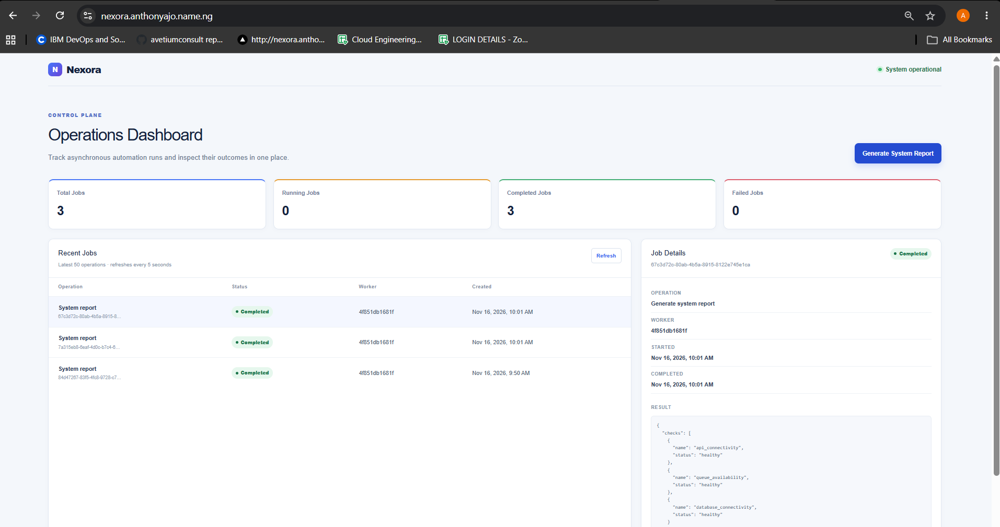

### AWS Infrastructure

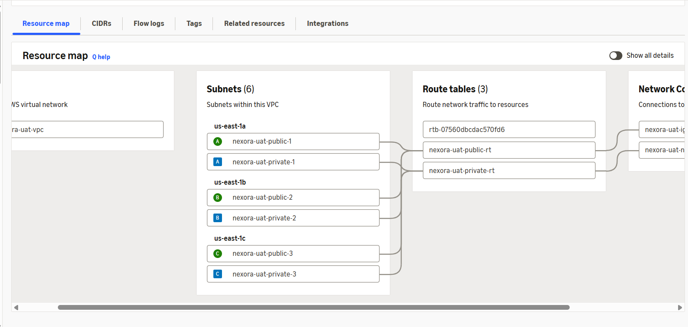

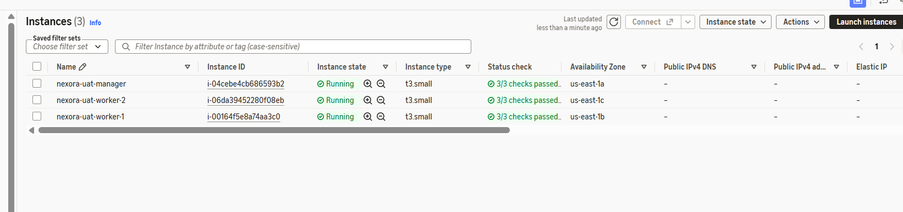

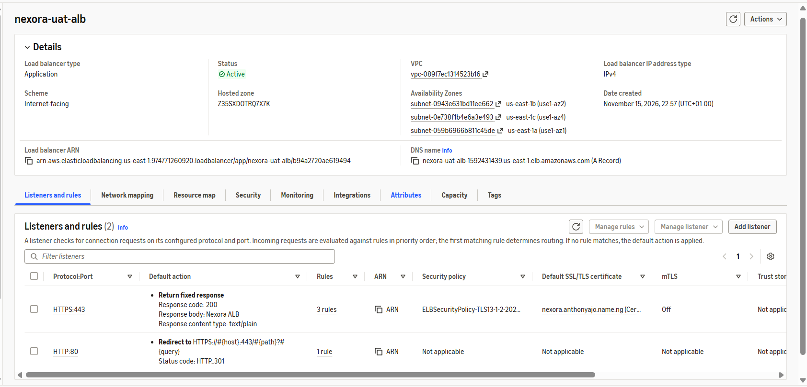

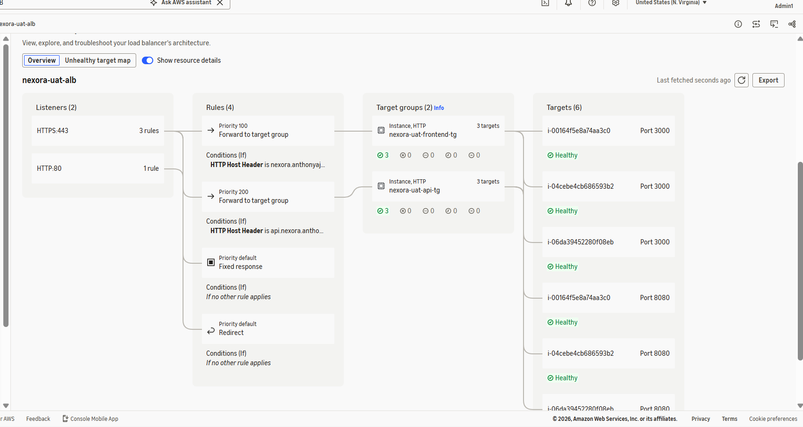

### CI/CD

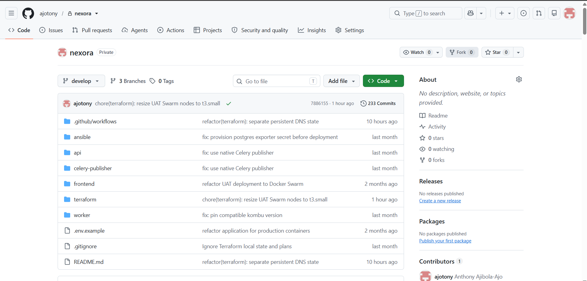

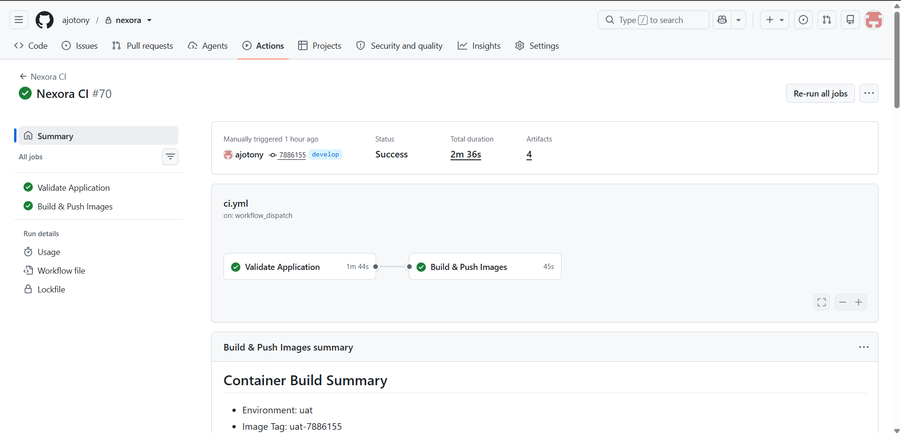

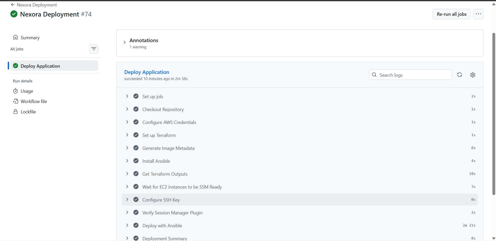

### Docker Swarm Deployment

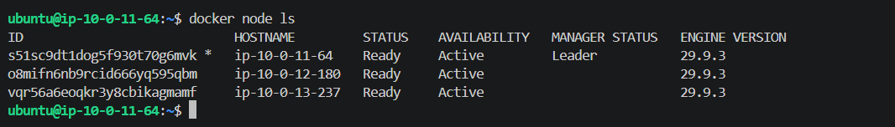

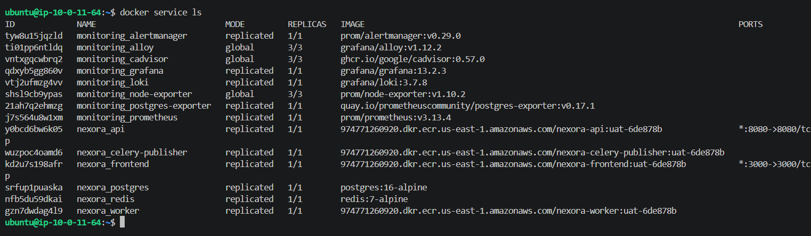

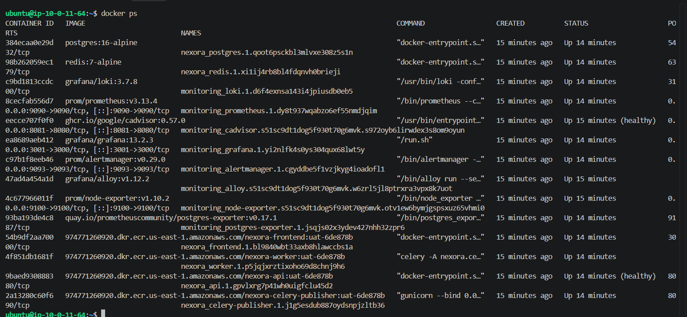

### Monitoring and Logging

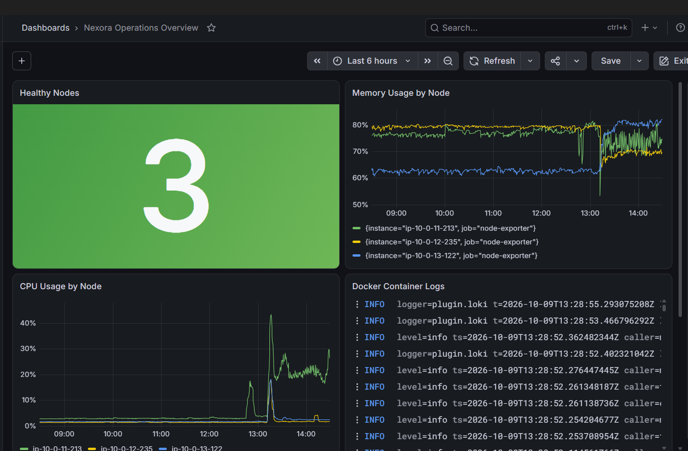

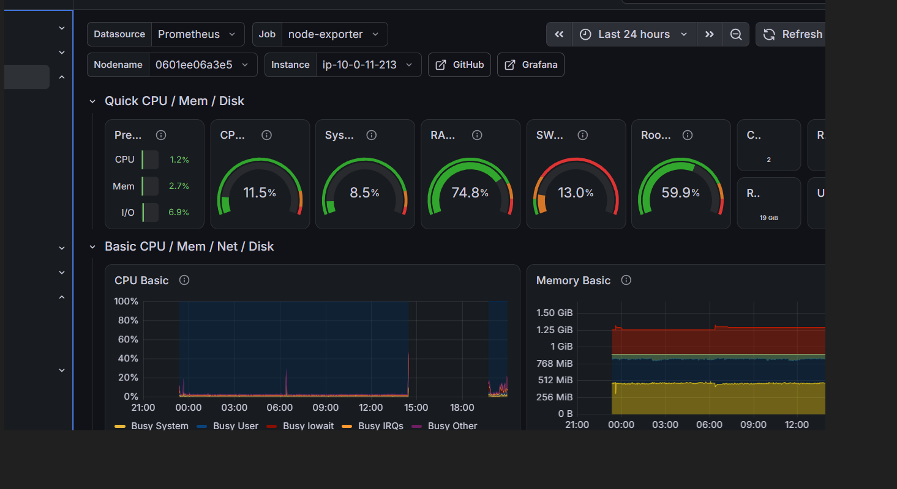

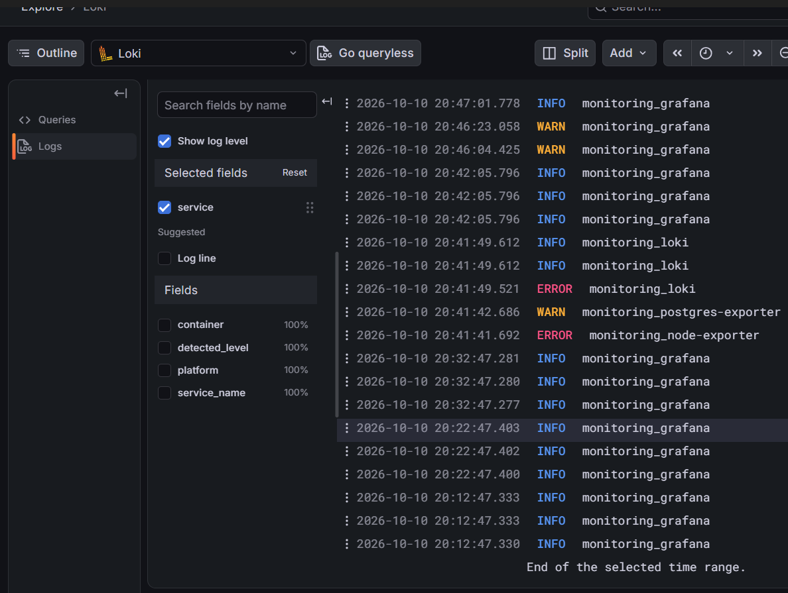

## Security Considerations

- Use GitHub Actions OIDC for AWS authentication instead of long-lived access keys.
- Apply least-privilege IAM permissions.
- Keep EC2 instances in private subnets where possible.
- Use Systems Manager for managed server access.
- Terminate public HTTP traffic at the ALB and enforce HTTPS.
- Store sensitive application and monitoring credentials securely.
- Avoid committing `.tfstate`, private keys, passwords, or secret files.
- Restrict access to monitoring interfaces.

## License

This project is licensed under the MIT License.
See the [LICENSE](LICENSE) file for details.

## Cleanup

Infrastructure destruction is a destructive operation and can result in data loss.

Before destroying an environment:

1. Confirm the target environment.
2. Review the Terraform destroy plan.
3. Back up any required persistent data.
4. Confirm that no production workloads depend on the resources.

The repository provides a manual destroy workflow with an explicit confirmation requirement. Use it only when the environment is approved for teardown.

---

**Nexora** demonstrates an end-to-end cloud deployment workflow combining AWS infrastructure provisioning, automated CI/CD, configuration management, Docker Swarm orchestration, and centralized observability.